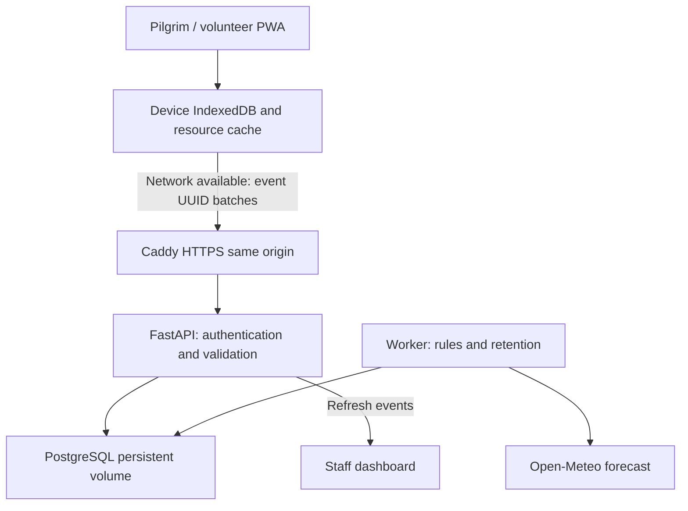
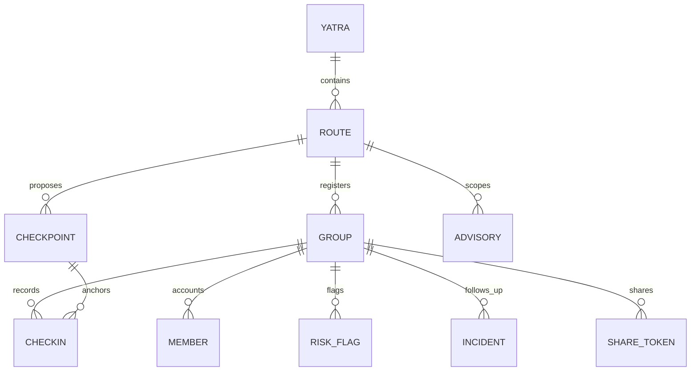
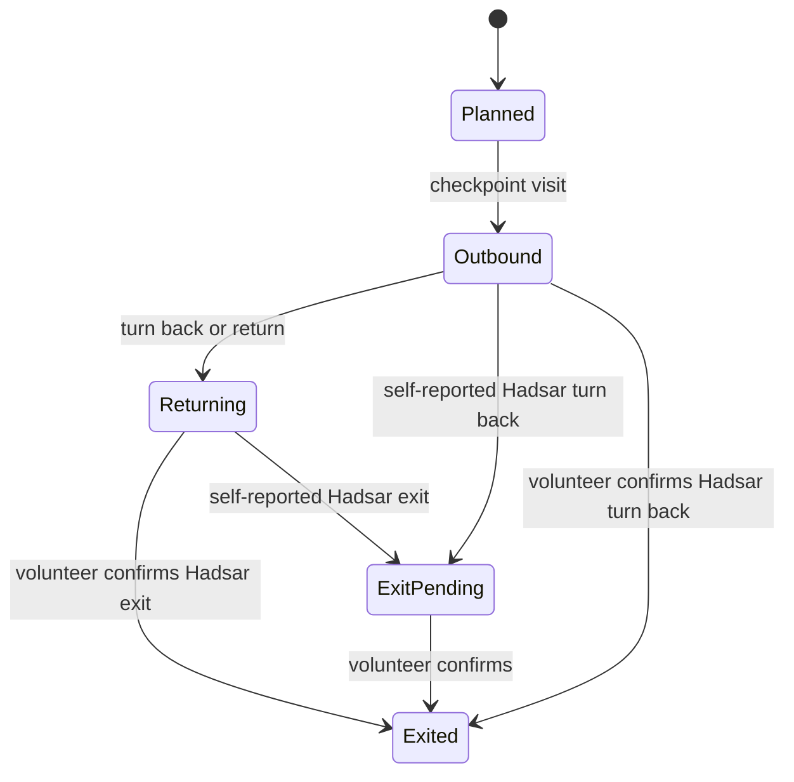

# Yatra Kavach architecture

## Boundary and purpose

Independent Manimahesh checkpoint coordination prototype. Proposed checkpoints are software configuration, not proof of staffed facilities. PostgreSQL is the production database; SQLite is a separate convenience mode. See TEST_REPORT.md for executed evidence, rather than treating this design as deployment evidence.

## Components

* `web/`: React + TypeScript/Vite; bilingual pages, pass QR, camera/manual scan, local queue, resource readiness, route packs, staff and family screens. The production build contains the service worker. Development-server behaviour is not evidence of production offline readiness.
* `api/app/routers/`: typed registration, check-in batch, health/SOS, staff dashboard, incidents, advisories and family-share APIs.
* `api/app/services/`: HMAC validation, conservative member journey projection, authentication, shared database rate limiter, forecasts, rules pipeline and retention worker.
* `api/alembic/`: versioned relational schema. Start scripts load the same root `.env` for migration, seed, API and worker.
* Caddy: HTTPS and same-origin API/SSE proxy. PostgreSQL volume stores application records; backups are a separate operator duty.

## Data model

Members have stable IDs even where anonymous labels are used. A check-in has an event UUID, checkpoint, selected member IDs, headcount, direction, source, device visit timestamp, receipt timestamp and validation outcome. The member projection records journey state and evidence source; the event history remains available for audit. Receipt rows support idempotency of queued actions.

## Offline and sync

1. Download and verify while online: app shell, scanner, route information, pass and advisories. Browser storage eviction or clearing invalidates this readiness.
2. Save events to IndexedDB before reporting local success. Local success means only that this device retained the event.
3. Upload bounded batches after reconnect; keep UUIDs across retry. Invalid tokens are rejected by the server. The browser only validates token format; the HMAC secret is never bundled.
4. Server acceptance and staff acknowledgment are different states. Preserve pending events on transport/server errors. A shared device must keep the required staff session for confirmed volunteer uploads.
5. Visit time and server receipt time remain separate. Clock-skew information supports uncertainty; device time is not an authoritative physical-presence proof.

This state machine applies per member. Lake arrival is still outbound; a group completes only after all member exits are confirmed. Mixed states produce a split group. Late outbound events cannot reverse a newer return or confirmed exit. Terminal exit is conservative; a new journey requires a new registration. Staff must reconcile mistaken terminal records through an auditable operator process rather than silently reusing a completed pass.

## Staff authentication and trust

Staff passwords are Argon2 hashes. JWT-backed HttpOnly sessions use Secure in production and SameSite=Strict. Exact-origin checks protect unsafe cookie requests. API role and route-scope checks are authoritative; hiding a button is not access control. Tokens and family links are bearer capabilities: possession grants their documented scope. The short group code is a prototype lookup capability, not strong identity authentication; never publicly distribute passes or assume the code proves who is present.

Checkpoint signatures prove issuance, not physical presence. Staff confirmation adds an authenticated staff observation. Phone numbers and staff notes must not appear in family links. Shares expire and can be revoked. Imported geometry and staff-entered advisory URLs remain untrusted data, not automatic official verification.

## Rules and live updates

`rules.yaml` is the source for thresholds and methodology. R1–R10 are triage heuristics pending clinical/rescue review. Reporting delays may mean no network. “Overdue” never proves someone missing, and no absence of flags proves safety. Return and split accounting must not be evaluated as a fresh outbound segment.

SSE carries refresh signals; authorised queries retrieve stored records. Reconnect refresh and polling support recovery. The in-process broadcaster is not a durable message bus; periodic refresh is the fallback between workers/restarts. Staff form state must not be overwritten by passive refresh. No claim of guaranteed instant delivery is made.

## Deployment limits

No background/locked-screen GPS guarantee; no remote SOS without transport; no fresh offline forecast; no reviewed Manimahesh navigation geometry. The model forecast cache is process-local and is not a historical meteorological archive. Device storage is not an encrypted clinical record store. Production readiness additionally requires deployment, load/security review, retention operations, field validation and monitored staffing.
