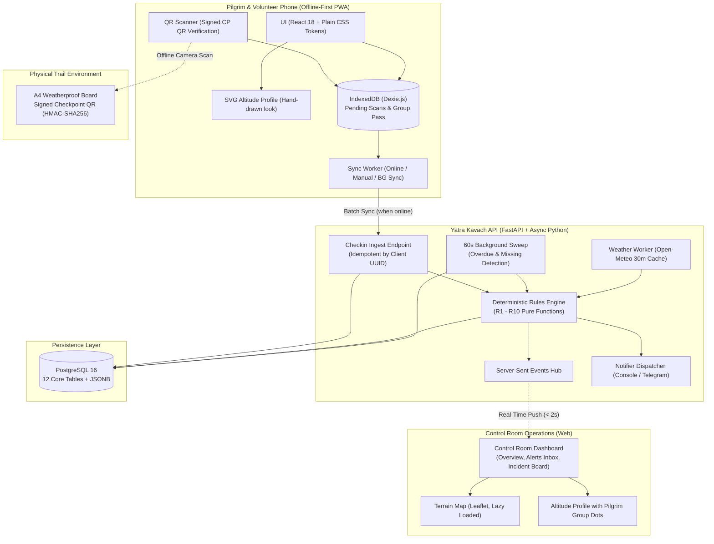

> Historical input-repository document. Not current acceptance evidence. Read root TEST_REPORT.md, IMPLEMENTATION_STATUS.md and HANDOVER.md for this delivery.

# Yatra Kavach - Master Plan & Architecture

Offline-first pilgrim-trail safety system for Himachal Pradesh (Manimahesh, Kinner Kailash, Shrikhand Mahadev).

## 1. System Architecture

---

## 2. Top Five Risks & Mitigations

| # | Risk | Impact | Mitigation Strategy |
|---|---|---|---|
| **1** | **Clock skew & untrusted timestamps on pilgrim phones** | Faulty speed/overdue rule triggers (e.g. false R1 fast ascent or R2 overdue) | Every sync measures delta from server `Date` header to calculate `clock_skew_s`. Event timestamps are normalized relative to server timeline; rules reject or flag anomalous future timestamps. |
| **2** | **QR code forgery or checkpoint tampering** | Malicious users forging check-ins to trick rescue systems | Checkpoint QRs are signed with HMAC-SHA256 (`YK1:CP:<id>:<hmac8>`). Secret keys stay in control room; server rejects any signature mismatch upon ingest. |
| **3** | **Network partition & burst sync overwhelm** | Hundreds of devices reconnecting simultaneously after passing a dead zone | Check-in ingest is strictly idempotent using client-generated UUID PKs and batched (`≤ 50` items). Bulk ingest runs as batched database upserts. |
| **4** | **Sensor / GPS unreliability in mountain ravines** | Pilgrim apps draining battery or crashing looking for GPS fix | Zero GPS dependence for primary safety path. Location is anchored by physical signed checkpoint scans. Pilgrim view has no map tiles; hand-written SVG altitude profile is primary. |
| **5** | **Alert fatigue in the control room** | Staff ignoring critical alarms amidst high check-in volumes | Unique deduplication constraints: only one open `risk_flag` per `(group_id, rule_id)`. Severity tiers (`info`, `watch`, `urgent`) strictly partitioned with explainable rule formulas and numbers. |

---

## 3. Verification status

The inherited sprint claims were not evidence of working integration. Current results are in VALIDATION.md.

- [x] Local API tests and frontend tests
- [x] TypeScript and production Vite build
- [x] Browser registration and offline reconnect flow at 360×640
- [x] Local API restart and both-direction persistence proof (SQLite fixture)
- [x] QR PNG decode round trips, printable A4 posters and guide
- [x] Lighthouse performance/accessibility/best-practices gate on local production build
- [ ] Docker image build and live PostgreSQL migrations/restart/restore on deployment host
- [ ] Real-phone camera, installation, SMS and airplane-mode validation
- [ ] Production-origin poster regeneration and installed-device decoding

---

## 4. Later (Post-Hackathon Backlog)

- LoRa / satellite mesh packet gateway for zero-cellular mountain passes.
- BLE beacon auto-checkin at high-capacity camps.
- Regional HP emergency dispatch integration (ERSS 112 API).
- Optional cached LLM-generated incident briefings for mountain rescue teams (flagged off).
